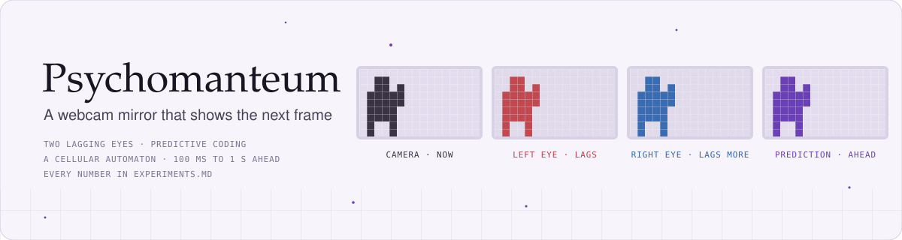

<picture>
  <source media="(prefers-color-scheme: dark)" srcset="docs/banner-dark.svg">
  
</picture>

# Psychomanteum

A webcam mirror whose image is the system's **prediction of a future frame**, drawn inside the
[Ghostty](https://ghostty.org) terminal, with Claude Code in the next pane closing the
perception–action loop. Built for the [CIMC](https://cimc.ai) hackathon (30 October 2026), then
pushed further over the two days after it. Every number below is logged, with its setup and
caveats, in [`EXPERIMENTS.md`](EXPERIMENTS.md) (entries E1–E35), including the things that did
not work.

## Main findings

*Skill* is 1 − (prediction error / baseline error): how much better the prediction is than the
baseline, on frames the system had not seen. The eye mirror's baseline is averaging the two eyes;
the automaton's is copying the current camera frame, so the two are not directly comparable
except in the matched test at the end of this list.

- **Two crude eyes beat one, and prediction beats averaging them.** With two 80×45 eyes, each
  lagging by its own wandering 0–4 frames plus noise, a precision-weighted blend of a learned
  model, a motion-compensated average and the plain average predicts the frame 100 ms ahead with
  **24% lower error than averaging the eyes**, better on 90% of frames and at every level of
  motion. Two eyes have 16% lower error than one. *(E15, E16)*
- **It holds up further out.** At 500 ms the same system fell to +14%; offering several push
  distances, smoothing the flow and adding a blurred guess, all weighed per patch by recent
  precision, took it to **+20% at 500 ms** and +26% at 100 ms. *(E17, E18)*
- **A neural cellular automaton predicts the full-colour frame one second ahead.** Each cell of a
  160×90 grid runs the same small learned rule on its 3×3 neighbours. Trained to minimise error it
  scores highest (+0.20 at full resolution) by **blurring**: it averages the possible futures.
  Reading its output as a motion field forces one crisp future at half the skill (+0.11); training
  every inner step to predict a little further (a *lineage*, 66 ms to 1.6 s) wins some back
  (+0.13, +0.15 with ten guesses combined). *(E21, E23)*
- **Why the crisp mirror "feels like now":** where things actually moved, it moved them **14% of
  the distance**. Under uncertainty the error-minimising motion is a small one, and scaling it up
  does not make it more right. *(E25)*
- **Precision weighting, done the only way that works at one second.** The sources are
  complementary: an oracle that knew each patch's error would nearly double the skill (+0.29). But
  accuracy is only known a second late, and weights from past accuracy go stale (a fixed blend did
  as well). A small gate that chooses per patch from **signals known now** (recent motion, the
  66 ms errors that have already arrived, the model's disagreement with itself) reaches **+0.17**,
  **+0.19 as a small MLP**, and stays positive when the person is still, where every single source
  loses to copying. Fourteen richer features added almost nothing. *(E29–E33, E35)*
- **It generalises.** Five minutes recorded in a different room, with the automaton, the gate and
  the fixed weights left untouched: every number within about 0.02 of the old held-out result and
  the same ranking. *(E34)*
- **What did not pay:** live learning (E22), an automaton that never resets its state (E24), a
  graph automaton on superpixels (E26–E28), richer gate features (E35). Under most of the dead
  ends sits one problem: a predictor that minimises error **hedges** when the future is uncertain.
- **Head to head, measured motion wins early and the learned automaton catches up.** On the same
  held-out frames, in grey at 160×90, against the same copy-the-frame baseline, the eye system
  leads by a wide margin at 133 ms (+0.35 vs +0.08) and by 0.1 at 533 ms (+0.23 vs +0.13); at one
  second the automaton's gate ties it (+0.188 vs +0.187). The two fail in opposite ways: the eye
  system's advantage is entirely in motion and it loses to copying whenever the person is still,
  while the automaton under-commits in motion and never loses much when still. *(E36)*

Everything comes from one person and two rooms, one training recording and one seed. Treat the
numbers as a careful single case, not a benchmark.

## How it works

### The eye mirror (`psychomanteum.py`)

```
camera ──► two eyes (80×45 grey, each with its own wandering 0–4 frame lag + noise)
            │
            ├─► per-eye V1: sparse predictive coding on 8×8 patches, 64 features,
            │   learned online by a local Hebbian-style rule (edges emerge in ~1 min)
            │
            └─► fused predictor, per patch, precision-weighted blend of
                  · a learned linear readout of both eyes' V1 activity
                  · the eyes' average pushed along its own motion (several reaches)
                  · a blurred average and the plain average
                ──► the mirror: the prediction `horizon` steps ahead, tinted purple;
                    where earlier predictions missed, pale ghosts appear
```

It runs at 30 fps on a laptop CPU, needs no network, and writes its prediction errors to
`state/stats.jsonl` every second. `mantis.py` reads them and changes settings in
`state/control.json`; the `/mantis` skill lets Claude Code run that loop.

### The automaton mirror (`nca.py`, `nca_mirror.py`)

A neural cellular automaton in PyTorch ([Mordvintsev et al., 2020](https://distill.pub/2020/growing-ca/)):
the current frame and the frames 100 and 200 ms earlier are written into the visible channels of
a 160×90 grid; a shared rule (3×3 identity, Sobel and Laplacian perception, then a 1×1 network)
updates 16 hidden channels 24 times. Read-outs:

| read-out | what it predicts | result |
|---|---|---|
| `delta` | a colour change, added to the frame | highest skill, blurry |
| `warp` | a motion field; the frame is resampled along it | crisp, half the skill |
| `lineage` | a motion field after every inner step: step *k* predicts 66 *k* ms ahead | best crisp model; ten predictions of the same moment can be combined |
| `persistent` | state carried over between frames, 6 steps per frame | stable for minutes, 3× cheaper, weaker |

The live mirror shows the lineage model one second ahead at full camera resolution, mixing four
sources per 8×8 patch with the gate from E32/E35: copy, the newest guess, the ten-guess average,
and the newest motion averaged within superpixels.

## Running it

Requirements: macOS with [Ghostty](https://ghostty.org) 1.3 or later (Kitty graphics over shared
memory; see E1), [uv](https://docs.astral.sh/uv/), a webcam with camera permission granted to
Ghostty, and, for training the automaton, an Apple-silicon GPU (it runs on CPU, slowly). Scripts
declare their own dependencies, so `uv run` is all you need.

**The eye mirror**

```sh
uv run psychomanteum.py                                   # live webcam
uv run psychomanteum.py --replay recordings/clip.mp4      # a recorded clip, looped
```

Keys: `d` dither · `f` features · `e` eyes used by the shown prediction (both / left / right) ·
`v` view (prediction / flow baseline / camera / error) · `+` `-` horizon · `r` record · `q` quit.

```sh
python3 mantis.py observe 10             # watch the mirror for 10 s: motion, error, skill, by region
python3 mantis.py set horizon=15         # change a setting live (values are clamped)
python3 mantis.py params
```

**The automaton mirror**

```sh
uv run nca_mirror.py --out lineage       # 1 s ahead, full colour; the gate is the default mix
uv run nca_mirror.py --out lineage --replay recordings/clip.mp4
```

Keys: `v` view (prediction / tracers / confidence / side by side / camera) · `m` mix (gate /
fixed blend / crisp / 10-guess average) · `[` `]` exaggerate the predicted motion for display ·
`,` `.` pull the motion toward whole superpixels · `r` record at camera rate · `q` quit.

**Training and evaluation** (the recording and its caches are not in the repository; record your
own with `r`, a few minutes of moving and standing still)

```sh
uv run nca.py prep recordings/clip.mp4                      # frames at 160×90 -> data/
uv run graph_nca.py prep                                    # superpixels for every frame -> data/
uv run nca.py train --out lineage --loss l1 --init-from warp --iters 1500
uv run nca.py eval recordings/clip.mp4 --out lineage        # held-out last 20%
uv run nca_mix.py baseline && uv run nca_mix.py gate        # the sources and the gate (E29, E32)
uv run nca_mix.py save-gate                                 # the gate the mirror loads
uv run nca_mix.py newroom recordings/other-room.mp4         # score everything on a new clip, nothing refitted
uv run evaluate.py recordings/clip.mp4 --horizon 15         # the eye mirror, offline
```

## Repository

| path | what |
|---|---|
| `psychomanteum.py` | the eye mirror: eyes, V1, fusion, motion compensation, precision mixing, Kitty graphics |
| `mantis.py`, `.claude/skills/mantis/` | Claude's senses and hands for the mirror, and the loop skill |
| `evaluate.py` | offline, prequential evaluation of the eye mirror on a recording |
| `nca.py`, `nca_mirror.py` | the automaton family and its live viewer |
| `nca_mix.py` | sources, precision weighting, the gate, the new-room test (E29–E35) |
| `graph_nca.py` | the graph automaton on superpixels (E26–E28) |
| `splash.py`, `kitty_bench.py`, `delayed_mirror.py`, `mirror.html`, `serve.py` | the splash pane and early experiments |
| `state/` | learned weights: V1 features, the fusion readout, automaton checkpoints, the gate |
| `results/` | logs and scripts behind the experiment entries |
| `EXPERIMENTS.md` | the log: question, setup, numbers, conclusion and caveats for every entry |
| `DEMO.md` | the five-minute demo script |

The results are also presented as a 3D chamber you can walk through; it is a private page and
has to be shared by its owner. Recordings, cached frames and screenshots never enter the
repository (see `.gitignore`); the demo footage shows people only at the system's 80×45 resolution.

## Method notes

- Every claim cites an entry. Entries record negative results too, and later entries never
  rewrite earlier ones; a correction is a new entry with a note on the old one.
- Live readings over a few seconds are too noisy to compare settings (identical settings ranged
  from +0.01 to +0.53, E5). Comparisons are made offline on a recording, prequentially (each
  prediction scored before the model learns from its target), with settings chosen on one half of
  the held-out stretch and reported on the other.
- The predictive-coding parts follow Olshausen & Field (1996) and Rao & Ballard (1999); precision
  weighting follows the predictive-processing reading of precision-weighted prediction errors; the
  graph automaton follows Grattarola, Livi & Alippi (2021). The resemblance of the crisp
  automaton's output to psychedelic visual effects is recorded as an untested hypothesis, with a
  pointer to the REBUS account, not as a finding.
